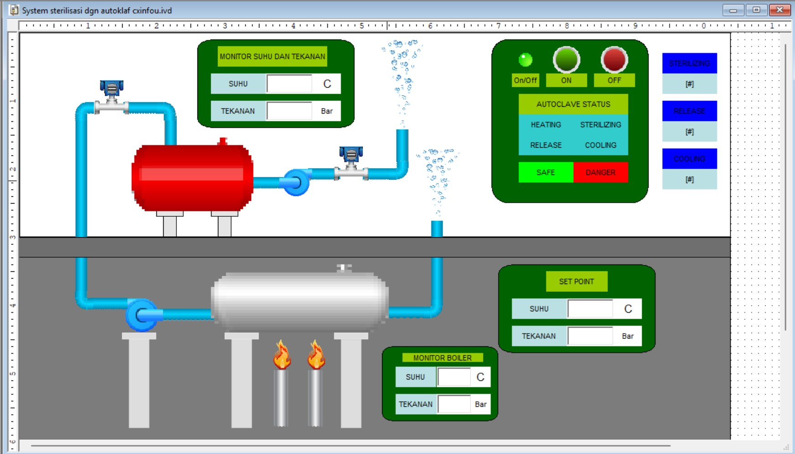
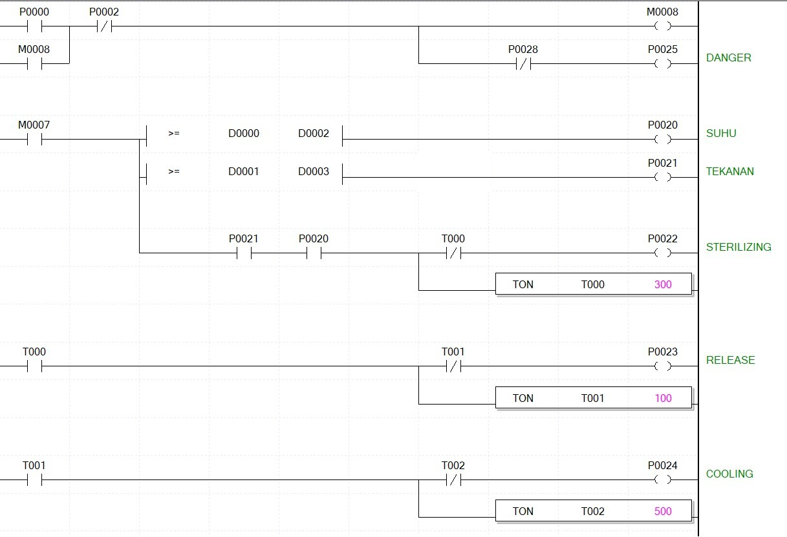
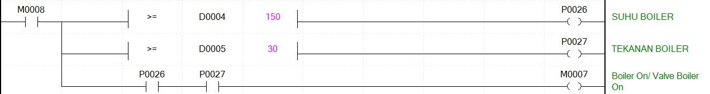

# SCADA Autoclave Steriliser

An InfoU SCADA screen and PLC ladder program that monitor and control an autoclave sterilisation cycle. Built as a two-person final-semester exam project.

## Overview

| | |
|---|---|
| **SCADA** | InfoU (LS ELECTRIC) |
| **PLC programming** | XG5000, CX-Programmer |
| **Process phases** | Heating, sterilizing, release, cooling |
| **Analog values** | Boiler temperature and pressure, autoclave temperature and pressure |
| **Set points** | Autoclave temperature and pressure |
| **Timers** | Sterilizing, release, cooling |

## Sterilisation cycle

1. **Heating:** Start latches the system and turns on DANGER. When the boiler reaches its temperature and pressure limits, the boiler valve opens and the autoclave heats to its set points.
2. **Sterilizing:** When both set points are reached, the sterilizing phase runs on timer T000.
3. **Release:** Timer T001 runs the pressure release phase.
4. **Cooling:** Timer T002 runs the cool-down, then SAFE replaces DANGER.

## Ladder program

Boiler interlock: D0004 >= 150 and D0005 >= 30 turn on M0007, which enables the autoclave rungs.

## PLC signals

| Address | Signal |
|---|---|
| P0000 | Start |
| P0002 | Stop |
| M0008 | Run latch |
| M0007 | Boiler on, boiler valve on |
| D0000, D0002 | Autoclave temperature, set point |
| D0001, D0003 | Autoclave pressure, set point |
| D0004, D0005 | Boiler temperature, boiler pressure |
| P0020, P0021 | Temperature reached, pressure reached |
| P0022 | Sterilizing |
| P0023 | Release |
| P0024 | Cooling |
| P0025 | DANGER |
| P0026, P0027 | Boiler temperature reached, boiler pressure reached |

| Timer | Phase | Preset |
|---|---|---|
| T000 | Sterilizing | 300 |
| T001 | Release | 100 |
| T002 | Cooling | 500 |

## Repository contents

| Path | Contents |
|---|---|
| `plc/` | XG5000 and CX-Programmer project files |
| `hmi/` | InfoU project, screen, tag database and drivers |
| `images/` | HMI and ladder screenshots |

Opening the project files requires XG5000, CX-Programmer or InfoU.
